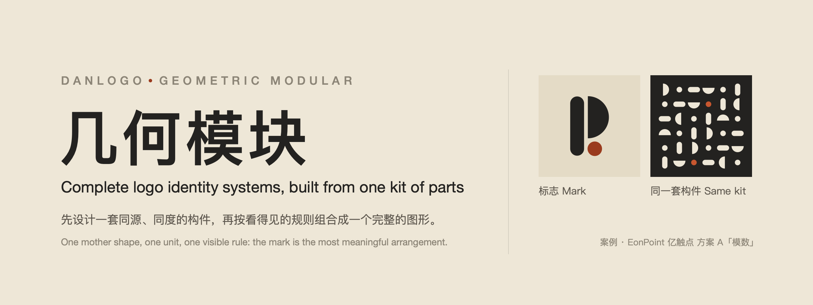
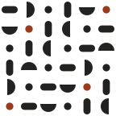

# danlogo-geomodular · Geometric Modular

English · [中文](README.zh-CN.md)



> A few notes, one rule, and a melody that can be varied without end.

The Geometric Modular direction of the danlogo series: a logo and brand-identity design skill for AI tools. It bundles a design style, a nine-stage working method and a set of drawing tools. The style's roots are the Chinese tradition of combinable furniture (the *Yanji* and *Dieji* table sets, the tangram), Froebel's gifts and the Bauhaus foundation course, concrete art, Karl Gerstner's programmatic design and modular architecture. It was distilled from the EonPoint 亿触点 scheme A "Modulus". It works with Claude (Claude Code, desktop, claude.ai), Codex, and any tool that reads the [Agent Skills](https://agentskills.io) format.

It fixes **character and quality**, not shapes, colours or techniques: every new brand grows its own form from its own name.

## The style

**Not tied to any industry**: choose it for the aesthetic. The industry only changes where the motif comes from.

**Locked formal language**: whole geometric primitives (full circles, half and quarter circles, capsules, whole arc bands, squares and rectangles, fixed-angle triangles), one unit of size, a grid with a fixed angle system, flat planes, and one deviation.

**Core relation: parts and their arrangement.** A kit of parts cut from one mother shape and sized by one unit is the base; the rule that arranges them is the star. The mark uses only 2–4 whole parts. Its meaning comes straight from the brand's name, as a relation between those parts.

| Gene | In one line |
|---|---|
| Same source | Every part comes from one mother shape |
| Same unit | Every size is a multiple or simple ratio of one unit, in three steps: large, medium, small |
| On the grid | Parts sit on one grid and turn only by a fixed angle system |
| Countable | Even gaps or clear interlocks; every part stays whole and can be counted |
| Meaning from arrangement | The meaning lies in how the parts are placed, not in what one part looks like |
| Whole planes | Each part is a whole primitive: not cut, no free curves, no polyline arcs |
| One deviation | In the orderly whole, only one thing differs, and it carries the meaning |
| One composition | The mark reads as one abstract composition, never a picture of an object |

**Element first, letter second.** The mark may also read as the brand's initial, provided the letter is *arranged* from whole parts rather than *written* and then geometrised. Remove the letter, and a sound composition should remain. Drawing an animal, plant, object, building, landscape or person is ruled out: that produces an icon-set pictogram, not a composition.

It sits between two failures. If the parts don't share a source and a unit, it becomes a collage. If they melt into one outline, the modules disappear.

## Case: EonPoint 亿触点 scheme A "Modulus"

Borrow the method, not the form. The shapes, colours and lettering of the case answer that brand's brief; they are not rules of the style. The case materials are **not** covered by the MIT License (see [License](#license)).

  

## Nine stages

1. Brief
2. Concepts: first a shortlist of 9 minimal sketches on one sheet for you to pick from, then 5 concept cards
3. Prototypes (at least 3 per concept), always rendered next to the case mark as a yardstick
4. Mark refinement
5. Final type and colour
6. System
7. Scenes
8. Proposal
9. Wrap-up: the AI asks whether to fold the project back into the skill

Every stage ends with your explicit confirmation.

## What's inside

```
SKILL.md                     Entry point: scope, three layers of rules, nine stages
references/
  philosophy.md              Style chapter 1: lineage and ideas
  exemplars.md               Appendix: reference works and how to use them without copying
  style-dna.md               Style chapter 2: genes, coordinates, knobs, touchstones
  creative-methods.md        Style chapter 3: motifs, the 9-sketch shortlist, concept cards
  style-extension.md         Style chapter 4: system, scenes and proposal aesthetics
  workflow.md · quality-gates.md · craft.md · deliverables.md · feedback-playbook.md
                             Shared danlogo-core chapters
cases/eonpoint-modular/      The case (not MIT-licensed)
examples/eonpoint-modular/   The case's source code (not MIT-licensed)
scripts/prim.py              Whole primitives with true arcs, and a part/size report
scripts/                     geom.py, sheet.py, render.sh, review.py and more
adapters/                    Claude vs Codex differences
agents/openai.yaml           Codex display metadata
evals/                       Test briefs and test records
PROMPT-CARD.md               Style prompt card: paste into any AI when the skill isn't installed
install.sh                   Install, update, package
```

## Install

```bash
git clone https://github.com/dan-cube/danlogo-geomodular.git
cd danlogo-geomodular
./install.sh            # installs for Claude Code (~/.claude/skills) and Codex (~/.agents/skills)
```

- One target only: `./install.sh claude` or `./install.sh codex` (restart Codex afterwards).
- claude.ai: run `./install.sh package`, or download `danlogo-geomodular.skill` from Releases, and upload it in claude.ai's skill settings.

## Use

Just ask, for example: "Design a logo for my coffee brand in the Geometric Modular style." In Codex you can call it explicitly with `$danlogo-geomodular`.

## Update

- `git pull && ./install.sh` updates your local install.
- At stage 9 the AI asks whether to fold the project into the skill; nothing is written without your approval, and `VERSION` and `CHANGELOG.md` are updated with it.
- The five `danlogo-core` chapters in `references/` are maintained by the danlogo series standard, not edited per skill.

## License

The skill's own text and code are released under the [MIT License](LICENSE).

**The EonPoint 亿触点 case is excluded.** Everything under `cases/eonpoint-modular/` and `examples/eonpoint-modular/`, and any image of the EonPoint marks, wordmarks, palettes or applications elsewhere in this repository, is © 2026 dan-cube, all rights reserved. It is published only so the method can be studied. Don't use, copy, modify, adapt or redistribute it, or use it as a logo or brand identity, without written permission. The EonPoint 亿触点 name belongs to its owner.
