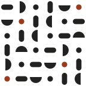

# danlogo-geomodular · 几何模块

[English](README.md) · 中文

> 几个音，一条规则，一段可以无限变奏的旋律。

danlogo 系列的几何模块方向：一个给 AI 用的 logo / 品牌标志设计 skill。它包含一种设计风格、一套九阶段工作方法和一组绘图工具。风格的思想来自中国的组合器物传统（燕几、蝶几、七巧板）、福禄贝尔的恩物与包豪斯基础课、具体艺术、格斯特纳的系统设计与模数建筑。沉淀自 EonPoint 亿触点的方案 A「模数」，适用于 Claude（Claude Code、桌面版、claude.ai）与 Codex，以及其他支持 [Agent Skills](https://agentskills.io) 格式的工具。

它规定**气质和质量**，不规定形状、颜色或工艺：每个新品牌都从自己的名字里长出新的形。

## 风格

**不限行业**：按审美来选它。行业只改变母题从哪里来。

**锁定的造型语言**：整件的几何基本形（整圆、半圆、四分之一圆、两端圆的条、整段的弧带、方与矩形、固定角的三角），一个尺寸单位，一个网格和固定的角度系统，平涂的面，一处偏差。

**核心构成：构件与组合。** 一套出自同一母形、同一尺寸单位的构件是基础，排列它们的规则是主角。标志只用 2–4 件整件的构件，意思直接来自品牌名，变成这几件之间的一个关系。

| 基因 | 一句话 |
|---|---|
| 同源 | 所有构件出自同一个母形 |
| 同度 | 尺寸都是一个单位的倍数或简单比例，分大、中、小三档 |
| 定向 | 构件落在同一个网格上，只按固定的角度系统转动 |
| 可数 | 间隙一致或明确咬合；每一件完整，数得出来 |
| 组合生义 | 意思来自怎么排，而不是某一件像什么 |
| 整件的面 | 每件都是整件的基本形：不切改，不用自由曲线，不用折线凑弧 |
| 稀疏的偏差 | 整齐里只有一处不同，意义放在那里 |
| 一个完整的构成 | 第一眼读成一个抽象构成，而不是一样东西的图 |

**元素先于字。** 标志可以同时读出品牌名的首字母，条件是字母由整件的构件**排**出来，而不是先**写**出一个字母再几何化；拿掉字母，它仍是一个成立的构成。不画动物、植物、器物、建筑、风景和人——那会变成图标库里的象形图，而不是构成。

它站在两种失败之间：构件没有共同的来源和尺寸，就成了拼贴；构件融成一个外轮廓，模块感就消失了。

## 案例：EonPoint 亿触点方案 A「模数」

只借方法，不借形式：案例里的形、颜色和字都是那个品牌的答案，不是本风格的规定。案例材料**不在 MIT 许可范围内**（见[许可](#许可)）。

  

## 九个阶段

1 简报 → 2 概念（先出一张 9 张极简速写的海选图给你挑，再写 5 张概念卡）→ 3 原型（每个概念 ≥3 套，始终和案例标志并排看）→ 4 图形精修 → 5 定稿（定制字 + 配色）→ 6 体系 → 7 场景 → 8 提案 → 9 总结（AI 询问是否把项目沉淀进 skill）

每个阶段都等你明确确认。

## 里面有什么

```
SKILL.md                     入口：定位、三层要求、九个阶段、贯穿规则
references/
  philosophy.md              风格章 1：思想坐标
  exemplars.md               风格章 1 附录：参照作品与示范用法
  style-dna.md               风格章 2：风格基因、风格坐标、旋钮、试金石
  creative-methods.md        风格章 3：母题、9 张海选、概念卡、防同质化
  style-extension.md         风格章 4：体系、场景、提案的审美
  workflow.md · quality-gates.md · craft.md · deliverables.md · feedback-playbook.md
                             danlogo 系列共用章节
cases/eonpoint-modular/      案例（不在 MIT 许可内）
examples/eonpoint-modular/   案例的生成代码（不在 MIT 许可内）
scripts/prim.py              整件的基本形、真正的圆弧、件数与大小层次报告
scripts/                     geom.py、sheet.py、render.sh、review.py 等通用工具
adapters/                    Claude 与 Codex 的使用差异
agents/openai.yaml           Codex 的显示信息
evals/                       测试简报与测试记录
PROMPT-CARD.md               风格提示词卡：没装 skill 时贴给任何 AI
install.sh                   安装 / 更新 / 打包
```

## 安装

```bash
git clone https://github.com/dan-cube/danlogo-geomodular.git
cd danlogo-geomodular
./install.sh            # 同时装到 Claude Code（~/.claude/skills）和 Codex（~/.agents/skills）
```

- 只装一个：`./install.sh claude` 或 `./install.sh codex`（Codex 需重启后生效）。
- claude.ai：运行 `./install.sh package`，或在 Releases 下载 `danlogo-geomodular.skill`，上传到 claude.ai 的技能设置里。

## 使用

直接说需求，例如：“用几何模块的风格，给我的咖啡品牌做一个 logo。”在 Codex 里可以用 `$danlogo-geomodular` 显式调用。

## 更新

- `git pull && ./install.sh` 更新本机安装。
- 第 9 阶段 AI 会询问是否把这个项目沉淀进来；你批准后才写入，并更新 `VERSION` 与 `CHANGELOG.md`。
- `references/` 中标有 `danlogo-core` 的五个共用章节由 danlogo 系列标准统一维护，不在单个 skill 里单独改。

## 许可

本 skill 自己的文字和代码采用 [MIT 许可](LICENSE)。

**EonPoint 亿触点案例除外。** `cases/eonpoint-modular/` 与 `examples/eonpoint-modular/` 下的全部内容，以及本仓库其他位置出现的 EonPoint 标志、字标、配色与应用的图片，设计版权归 dan-cube 所有，保留一切权利。它们只为学习方法而公开；未经书面许可，不得使用、复制、修改、改编、再分发，也不得用作标志或品牌形象。EonPoint 亿触点的名称归其所有者所有。
